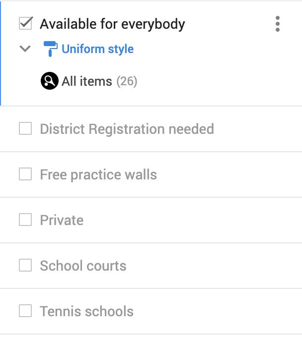
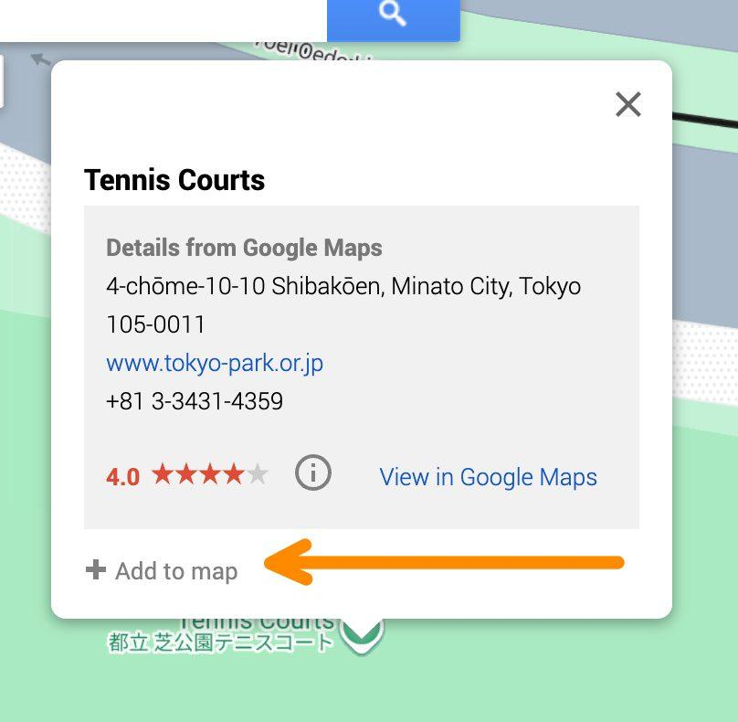
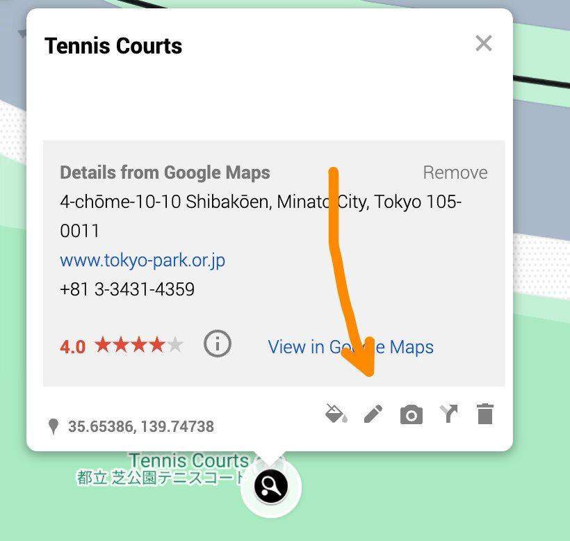
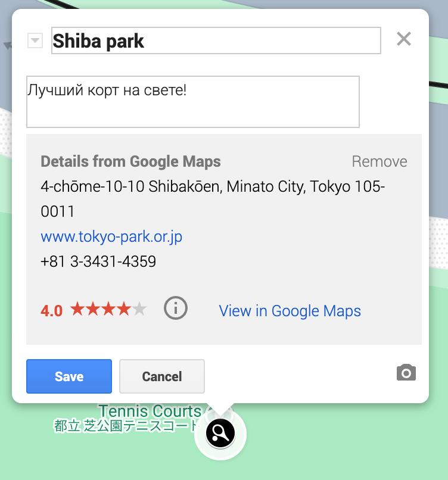

# Хочу добавить корт, а как?

Давайте разбираться!

Шаг 1: выбираем слой, на который хотим добавить объект

Шаг 2: выбираем точку на карте и кликаем на неё и жмём "Add to map"

Шаг 3: меняем название, добавляем комментарий

Спасибо за ваш вклад! ❤️
